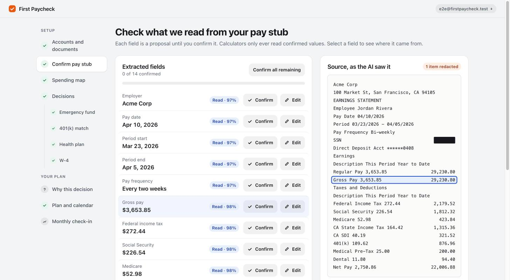
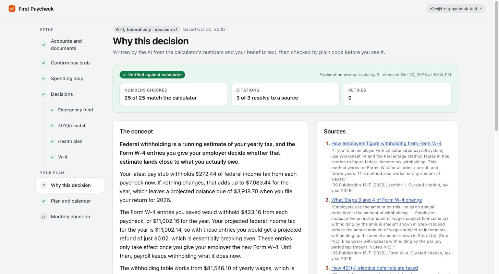
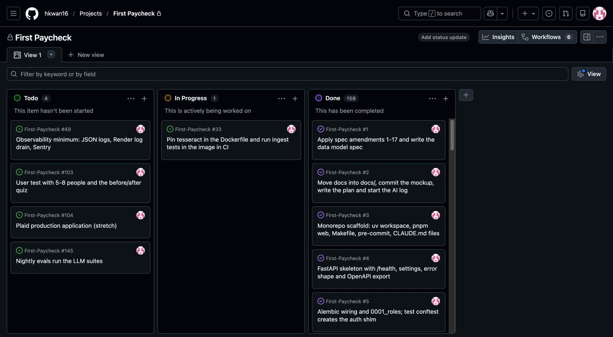

# First Paycheck: Alpha Release and Task Backlog

Due Thursday, November 5, 2026. This document follows the three sections of the [alpha brief](../alpha-brief.md): the working demo, the backlog, and a reflection on building with AI tools.

## Early working demo

First Paycheck guides a new salaried employee through the money decisions of their first month (the Form W-4, the health plan, the 401(k) contribution, the emergency fund, and what is safe to spend) using their own pay stub, benefits summary, and bank data. Every number comes from tested code in `api/calc/`, which works in integer cents. Claude only reads documents, labels transactions, and explains decisions, and anything it produces stays a proposal until the person confirms it. Each month, a check-in compares the bank data and the newest pay stub against the saved plan to see whether the decisions took effect.

The alpha was scoped as milestones M0 to M4: sign in, link a bank, confirm a pay stub, and make the 401(k) decision with its explanation. The rest of the MVP, planned for November 6 to December 11, was built ahead of schedule, so production today runs every milestone through M10. The web app is at <https://first-paycheck-silk.vercel.app> (Vercel), and the API and worker run on Render at <https://first-paycheck-api.onrender.com>. On November 1, its `/health` reported commit `ba3898b`, migration `0019_explanation_context_digest`, a live worker, and the Plaid sandbox.

A person moves through the product in this order:

1. **Link a bank** through Plaid Link (the sandbox) or a CSV export. A background job syncs the accounts and transactions.
2. **Upload and confirm a pay stub.** Social Security and account numbers are blacked out before Claude sees a page. Claude proposes each field beside the line it came from, and the person confirms or edits every one, while the screen and the API check that gross pay minus deductions equals net pay.
3. **Spending.** Each transaction shows its category and who chose it (a rule, the AI with its confidence, or the person), and fixing one saves a rule. Summary tiles, a cash-flow diagram, and the recurring charges sit above the list.
4. **Decisions.** Four steps, one calculator each: emergency fund, 401(k) match, health plan, and W-4. Saving stores an immutable version, so a change saves v2 over v1.
5. **Why.** Claude explains a saved decision in plain language. The API checks every number against the calculator and requires an IRS citation, and if the check fails twice, the screen shows the calculator's own result instead.
6. **Plan and check-in.** The plan collects every decision and the next 90 days of dates, with a PDF and a calendar file. The monthly check-in lists what changed since then, such as an election that never reached the pay stub, and compares the month's cash flow with the plan.

### Recording and screenshots

A two-minute recording of that path, [`alpha-demo.mp4`](alpha-demo.mp4), was made on production on November 1 by a Playwright spec (`web/e2e/capture-demo.spec.ts`), with a caption naming each step. The screenshots in [`screenshots/`](screenshots/) were taken from production on November 1, signed in as the synthetic test user with the model live, through Claude in Chrome.

| File | Shows |
|---|---|
| `01-link-accounts.jpg` | The seven linked sandbox accounts, with their roles and balances |
| `02-link-documents.jpg` | The uploaded documents, each with its redaction badge and status |
| `03-confirm-review.jpg` | The Confirm screen: Claude's proposed fields with their confidence, beside the redacted source, with the selected field's line outlined |
| `04-spending-summary.jpg` | October's summary tiles (income, essentials, flexible, and savings) |
| `05-spending-cash-flow.jpg` | The cash-flow diagram from income to categories, with the Dining popover open |
| `06-spending-transactions.jpg` | Transactions with their category source: a rule, the AI with its confidence, or a fix by the person |
| `07-decisions-401k.jpg` | The 401(k) step: the employer's match, the pay stub's current rate, and the calculator's result |
| `08-decisions-w4.jpg` | The W-4 step, reading the saved 401(k) and health plan decisions |
| `09-why-verified.jpg` | The W-4 explanation: 25 of 25 numbers match the calculator, and 3 of 3 citations resolve to IRS sources |
| `10-plan.jpg` | The plan: the paycheck, each decision, the exports, and the next 90 days |
| `11-check-in-findings.jpg` | October's check-in: new recurring charges, each with the part of the plan it affects |
| `12-check-in-cash-flow.jpg` | November's cash flow against the plan, and net worth by month |

### Functional and placeholder features

Every feature on the path above is functional in production. The table lists what is still partial or missing.

| Feature | Status |
|---|---|
| Sign-in, bank linking, CSV import, upload with redaction, Confirm, Spending, the four calculators, versioned decisions, verified explanations, the plan with its PDF and calendar file, monthly check-ins, net worth, and account deletion | Functional |
| Bank data | Plaid's sandbox only. Production access to real banks (#104) is a stretch goal and has not started. |
| Screen size | Desktop only, since November 1. The layout still adapts to a narrow window, but nothing is designed or tested for a phone. |
| LLM evals | Every LLM suite has a measured baseline from live runs. The nightly workflow runs only the free suites, because the API key is not yet a GitHub secret (#145). |
| Error reporting (#49) | JSON logs and the Sentry hooks are in the code, but Sentry is not turned on in production. That is deferred until after the alpha. |
| User test with 5 to 8 people (#103) | The kit is written (`docs/user-test/`), but the sessions have not run. |

## Documented backlog

The backlog is a GitHub Project: <https://github.com/users/hkwan16/projects/1>, with the issues at <https://github.com/hkwan16/First-Paycheck/issues>. Each issue has a title, a description that ends with its definition of done, a status (To Do, In Progress, or Done), a priority (High, Medium, or Low), a milestone, and area labels. Every issue is assigned to me, since this is a solo project. The source of truth is [`docs/backlog.yaml`](../backlog.yaml), which `scripts/sync_backlog.py` syncs to GitHub, so the board follows the repo.

The backlog holds 163 issues: 158 done, 1 in progress, and 4 to do (56 High, 91 Medium, and 16 Low). Milestones M0 to M10 are ordered by dependency, and each one ends with a deployed product. Since October 22, 32 issues have been added, most of them bugs found by testing production end to end. The last was found while recording the demo: a pay stub confirmed twice counted its pay twice (#190), fixed the same day. The five open issues are the ones that need something from outside the repo or are deferred:

| Issue | Status | What it waits on |
|---|---|---|
| #33 Tesseract pinned in Docker and the ingest tests required in CI | In progress | Marking the `ingest-in-docker` job as a required check |
| #49 JSON logs, a Render log drain, and Sentry | To do | Deferred: the Sentry DSN and log drain in Render, and a forced error to trace |
| #103 User test with 5 to 8 people | To do | Participants |
| #104 Plaid production application | To do | An application to Plaid (stretch) |
| #145 Nightly LLM evals | To do | The API key as a GitHub secret, about $1.30 a day |

## Brief reflection on AI tool integration

This reflection draws on [`docs/ai-log.md`](../ai-log.md), where I record each notable use of an AI tool, what went wrong, and how it was caught.

### Tools used

I built First Paycheck with Claude Code. A main session planned the work and wrote the specs, then split each milestone into packages for Opus 5.5 subagents. Each subagent worked in its own git worktree with its own test database, and it had to pass a gated command before reporting back. Sixteen subagents built M3 to M10 in one day, two to four at a time, and the main session reviewed and merged their branches. Since then, I have used Claude in Chrome to test production as a person would, clicking through every screen as the synthetic test user.

### How the tools changed the work

Planning was where the tools helped most. Because the build plan was grounded in the proposal and the technical spec, it produced seventeen spec amendments before any code was written: integer cents in every money column, a non-production route for linking Plaid's sandbox, and a committed OpenAPI file that generates the web client's types. With that contract in place, subagents could build the API and the web client side by side. Every merge waited on lint, the test suites, and the free evals, and the suites now hold 2,516 Python tests and 1,692 web tests. The cost was orchestration: roughly a third of the main session went to merges and conflict resolution.

The rules for the AI live in the repo's `CLAUDE.md` files: money math only in `api/calc/`, one module that may call Claude, a failing test before every fix, and nothing the model produces saved without the person's confirmation. Tests and lint enforce those rules instead of the prompt.

### Successes, challenges, and surprises

- **A healthy-looking production can still be wrong.** On October 29, the key was saved on Render as `ABTHROPIC_API_KEY`. Production started without a model, fell back to rules and manual entry as designed, and looked fine. Production now refuses to start without the key (#133).
- **Testing production like a user found what unit tests missed.** Four passes with Claude in Chrome found 25 bugs between #132 and #184, such as a paused savings goal that still said it was on pace and a document that could never be read again after a fallback to manual entry. CI was green when each one was found.
- **A verified explanation can still mislead.** Twice, an explanation called a planned figure the one in effect. The W-4 explanation said the new entries' $423.16 per paycheck was withheld now, while the pay stub withheld $272.44 (#181). The number checker accepted it because the explain context had labeled the figure that way. The fix put the pay stub's figure into the context and added an LLM judge, calibrated on labeled examples, to the eval.
- **A test can pass without testing anything.** When the product became desktop only, the test for issue 172 (a step link should land at the top of the next page) passed at desktop size even with the fix removed. It now runs in a window where the bug appears and fails if that window stops showing it.
- **Parallel agents need a shared map.** Two agents' migrations kept revising the same parent until the briefs named the current head. Merges conflicted in shared files, and `tsc` in the merge gate caught two wrong resolutions.

The next steps are the user test with 5 to 8 people, the nightly LLM evals, and making the `ingest-in-docker` job a required check (#33) before the final release.
