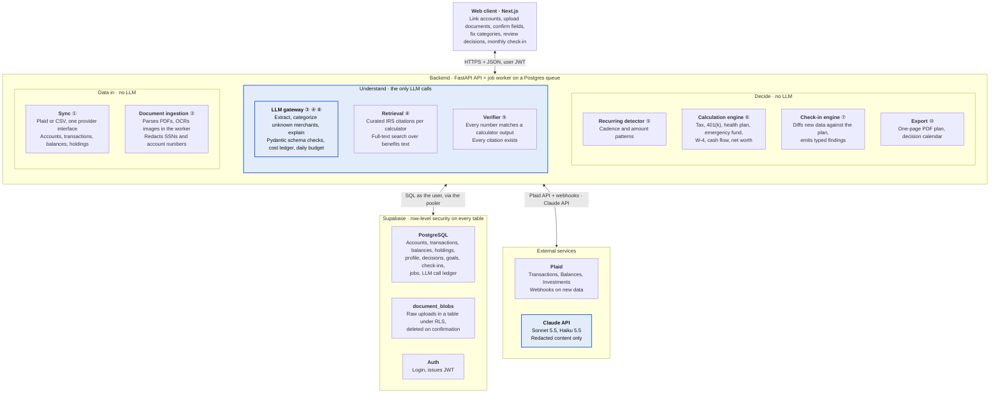
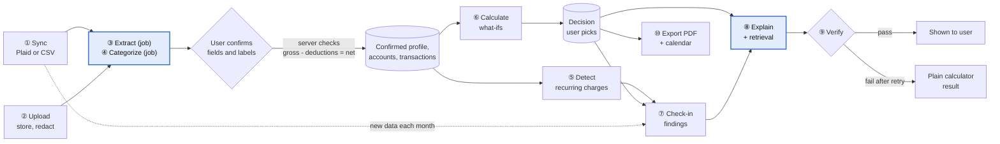

# First Paycheck Financial Setup: Technical Spec

First Paycheck is a web app that guides a new salaried employee through their first-month money decisions, then checks in every month to see whether those decisions stuck and what changed. It works from the user's own pay stub, benefits documents and linked bank accounts. All financial math runs in deterministic, tested code. The LLM only extracts, categorizes and explains.

This is the amended spec. It differs from `Technical-Spec-Finalized.pdf` in the ways listed under [Changes since the finalized PDF](#changes-since-the-finalized-pdf) at the end.

## 1. Architecture

A Next.js client, a FastAPI backend with a separate job worker, and Supabase (database and login). Raw uploads live in a database table under row-level security until the user confirms them. Bank data arrives through a sync provider (Plaid) or a CSV import, both feeding one pipeline. Only the LLM gateway calls Claude, and it records every call in a cost ledger; the calculation engine does all money math with no LLM.

**Only the LLM gateway talks to Claude; all money math stays in tested code.** Blue boxes are the only parts that touch an LLM; circled numbers are the data-flow steps below. Every other component is plain, tested code.

**The LLM never feeds money math directly.** Everything the LLM extracts or labels is a proposal until the user confirms it. The calculators read only confirmed data. Setup and the monthly check-in are two views over the same pipeline.

Data flow (numbers match the diagrams):

1. **Sync (no LLM):** The user links a bank through Plaid Link, or uploads a CSV for an account they won't link. Both go through the same provider interface and land in the same tables: `accounts`, `transactions`, `balance_snapshots`, `holdings`. Plaid webhooks trigger incremental syncs, and the user can also ask for one (`POST /sync/items/{id}/sync`), which is the only refresh path where webhooks cannot arrive, such as a laptop. A CSV import is a one-shot sync. Every transaction follows Plaid's sign convention, `amount_cents > 0` is money out, and the CSV provider normalizes its file to it. Provider access tokens are encrypted at rest and never leave the backend.
2. **Upload (no LLM):** The user uploads a pay stub or offer letter and a benefits summary. The raw bytes go to the `document_blobs` table under row-level security, through `ingest/store.py`, the only module that touches that table. Ingestion reads each file (pdfplumber for text-layer PDFs, OCR for images and scanned PDFs) and redacts SSNs and account numbers before anything is sent to an LLM. In images, the redaction blacks out the matching regions.
3. **Extract (LLM, background job):** `POST /docs/{id}/extract` returns a `job_id`; the worker runs OCR, redaction and the Sonnet 5.5 call, because together they take 15 to 60 seconds and pull heavy dependencies the API process should not carry. The client polls the job and then reads the proposal from `GET /docs/{id}`. Claude returns typed JSON fields, Pydantic checks them, and the user confirms each one. The model's self-reported confidence only decides which fields the UI marks "needs review"; accuracy is measured by evals. Before a pay stub is saved, gross minus deductions must equal net: the client checks it as the user edits, and the server enforces it with a 422 on confirm. Confirmed pay stub fields are stored as a `pay_stubs` row; confirmed plan options as `benefits_plans` rows. The benefits summary text is chunked and indexed for retrieval, and the raw upload is deleted from `document_blobs` in the same transaction.
4. **Categorize (LLM, unknown merchants only):** A background job normalizes each merchant name to `merchant_norm` (lowercased, digits and store numbers stripped) and applies rules in a fixed order: the user's exact rules, the user's prefix rules, seed exact rules, seed prefix rules, then seed rules that match a word anywhere in the description (`payroll`, `ppd id`), for money in only. A rule for a spending category labels money out only, so a paycheck from an employer named like a restaurant is income, never dining. Only merchants that match none go to Claude, in batches, with a confidence score. The user can fix any label; each fix becomes a user rule, so the same merchant never goes back to the LLM. Rules are plain strings matched exactly or by prefix, never regular expressions built from user input.
5. **Detect recurring charges (no LLM):** A job finds merchants that repeat on a weekly, monthly or yearly cadence at a stable amount and records them in `recurring_charges`. New, changed and stopped charges are flagged for the next check-in.
6. **Calculate (no LLM):** The stateless calculators run on confirmed data, so the user can try what-ifs freely. Money is integer cents throughout. The tax year comes from the pay stub's `pay_date` and is passed to every calculator explicitly, because October to December 2026 and January 2027 sit in different tax years. The result the user chooses is saved as a `decisions` row. The emergency fund decision also creates a `goals` row linked to the savings account.
7. **Check-in (no LLM):** Monthly, or whenever a sync lands new data, the check-in engine diffs the new data against the plan and emits typed findings: a 401(k) election that doesn't match the latest pay stub, a goal that is off pace, a new recurring charge, a pay or deduction change, an upcoming calendar date. Each finding names the decision it affects, so the user can re-run that calculator with current numbers.
8. **Explain (LLM + retrieval):** Claude explains each decision or finding from the calculator's numbers, the curated IRS citations for that calculator, and full-text search results from the user's benefits text.
9. **Verify (no LLM):** Plain code checks that every number in the explanation matches a calculator output and every citation exists. A failed check gets one retry, then the user sees the plain calculator result, flagged as a fallback.
10. **Export (no LLM):** Decisions become a one-page PDF plan, along with the user's decision calendar of dated checkpoints.

## 2. Data Model

PostgreSQL with row-level security on every table; every user row carries `user_id`. Every money column is a `bigint` named `*_cents`, and the API models it as `Cents = Annotated[int, Field(strict=True)]`, so a float can never slip in. Timestamps are UTC. Nothing the LLM produced is written to a confirmed table until the user accepts it. Column types, constraints, indexes and policies are in [`docs/specs/001-data-model.md`](specs/001-data-model.md).

| Table | Purpose | Key columns |
|---|---|---|
| `profiles` | The confirmed picture of the user's job and choices | salary_cents, pay_frequency, filing_status, other_jobs, dependents, expected_healthcare_usage, start_date, match_tiers (jsonb list of `{employee_pct_upto, employer_pct}`), vesting_years |
| `documents` | One row per upload, kept after the file is deleted | type (pay_stub, offer_letter, benefits), status, proposal, redaction_count, deleted_at |
| `document_blobs` | Raw upload bytes until confirmation; touched only by `ingest/store.py` | document_id, user_id, bytes, content_type |
| `pay_stubs` | Confirmed fields from each pay stub, one per upload | document_id, pay_date, tax_year (from pay_date), period_start, period_end, gross_cents, federal_withholding_cents, social_security_cents, medicare_cents, state_tax_cents, retirement_contribution_cents, medical_premium_cents, net_cents |
| `benefits_plans` | Confirmed plan options from the benefits summary | name, kind (hdhp, ppo, hmo), premium_per_period_cents, deductible_cents, oop_max_cents, coinsurance, employer_hsa_cents, enrollment_deadline |
| `benefits_chunks` | Chunked benefits text with a `tsvector` for retrieval | document_id, chunk_index, text, search |
| `sync_items` | One per linked institution | provider (plaid, csv), provider_item_id, access_token (encrypted), cursor, status, last_synced_at |
| `accounts` | Every bank, card, loan, investment or retirement account | sync_item_id, provider_account_id, kind (checking, savings, credit, loan, investment, retirement), name, mask, role (spending, emergency_fund, retirement), is_active |
| `transactions` | Every transaction, from any provider; `amount_cents > 0` is money out | account_id, provider_txn_id, posted_at, amount_cents, merchant_raw, merchant_clean, merchant_norm, category, category_source (rule, user, llm), confidence, pending |
| `category_rules` | Merchant to category mappings, seeded and learned from user fixes | user_id (NULL for seed rows), merchant_norm, match (exact, prefix), category, source (seed, user) |
| `balance_snapshots` | Balance per account per sync | account_id, as_of, balance_cents |
| `holdings` | Investment positions from Plaid Investments | account_id, as_of, security_id, name, ticker, quantity, value_cents, cost_basis_cents |
| `recurring_charges` | Detected subscriptions and bills | merchant_clean, cadence, typical_amount_cents, first_seen, last_seen, status (active, new, changed, stopped), user_status (confirmed, ignored, cancelled) |
| `goals` | Savings targets tracked against account balances | kind (emergency_fund, custom), target_amount_cents, monthly_contribution_cents, account_id, decision_id, target_date |
| `decisions` | Every chosen calculator result, versioned and immutable | calculator, inputs, result, version, supersedes_id, check_in_id, created_at |
| `explanations` | Each explanation attempt | decision_id or finding_id, text, citations, prompt_version, verified, fallback, verification counts |
| `check_ins` | One per monthly review or data-triggered review | period, triggered_by (schedule, sync, manual), status, completed_at |
| `check_in_findings` | Typed findings for one check-in | check_in_id, kind, severity, decision_id, payload, user_action (done, dismissed, or null) |
| `calendar_events` | Dated checkpoints derived from decisions and plans | kind, due_at, decision_id, status |
| `jobs` | Background work queue | kind, status, progress, payload, result, attempts, run_after, heartbeat_at, idempotency_key |
| `llm_calls` | One row per Claude call: the cost ledger and the source of the fallback-rate metric | purpose, model, prompt_version, input_tokens, output_tokens, cache_read_tokens, cost_microcents, latency_ms, status, job_id |
| `irs_citations` | Curated passages per calculator, versioned by tax year | calculator, key, title, url, passage, tax_year |

Rules that keep the model honest:

- `decisions` are never updated in place. A new choice inserts a new version with `supersedes_id`, so a check-in can show what changed and why. The database enforces a linear, immutable chain: `UNIQUE (user_id, calculator, version)`, a partial unique index on `supersedes_id` so a version has at most one successor, `CHECK ((version = 1) = (supersedes_id IS NULL))`, and a trigger that rejects every `UPDATE` and `DELETE`. The current decision for a calculator is the row that no other row's `supersedes_id` points to. The insert policy checks that the superseded row belongs to the same user.
- `pay_stubs` keep one row per upload, so the check-in can compare the latest stub against the one the plan was built on.
- `category_rules` grow from user corrections. Categorization accuracy improves per user without any LLM fine-tuning, and the LLM share of categorization falls over time. Seed rows have `user_id NULL` and are readable by every user; precedence is user exact, user prefix, seed exact, seed prefix, seed contains, then the LLM, counting only rules that apply to the transaction's direction (spec 003 rules 3a-4).
- `profiles.match_tiers` and `profiles.vesting_years` hold the employer's 401(k) match formula, confirmed from the benefits summary or entered by hand. Tier `{employee_pct_upto: 3, employer_pct: 100}` followed by `{employee_pct_upto: 5, employer_pct: 50}` means 100% of the first 3% of salary plus 50% of the next 2%.
- `sync_items.access_token` is encrypted with a key held only by the backend. Webhook payloads are verified against Plaid's signature before any job is queued.
- `llm_calls` stores counts, cost and status, never prompt or output text. The gateway sums a user's cost for the current UTC day and refuses a call past the per-user daily budget.
- Raw uploads are deleted from `document_blobs` after confirmation; transactions, balances and holdings are kept as long as the account is linked, and deleted when the user unlinks it.

## 3. API Design

REST and JSON (multipart for uploads). The client logs in with Supabase Auth and sends the resulting JWT on every route. The backend runs each database query as that user by forwarding the JWT claims to Postgres, so row-level security on every table limits each user to their own data, and another user's row reads as 404, never 403. An automated test tries to read another user's rows through every route, and a meta-test fails when a route is not covered. The one route without a user JWT is the Plaid webhook, which is verified by signature instead.

SQL that crosses users exists in three audited places: the job queue and scheduler in `jobs/`, which run on the privileged connection, and two `SECURITY DEFINER` functions executable only by `app_api`: `enqueue_sync_for_plaid_item(text)`, which the webhook calls to map a Plaid item to its owner, and `delete_user_account(uuid)`, which `DELETE /me` calls to delete the signed-in user's `auth.users` row and, through `ON DELETE CASCADE`, every row they own (spec 017). Every job handler then opens a user-scoped session under row-level security.

The API's OpenAPI document is committed as `api/openapi.json` (exported by `python -m app.openapi`) with stable `operation_id`s; `openapi-typescript` generates `web/src/lib/api/schema.d.ts` from it, and CI fails when either file drifts from the code.

**Documents and profile**

| Endpoint | Purpose: input → output | LLM |
|---|---|---|
| `POST /docs` | Upload: PDF or image (PNG, JPEG) + type (pay stub, offer letter, benefits) → document_id; bytes stored in `document_blobs` | No |
| `GET /docs` | → the user's documents with type, status and redaction count | No |
| `GET /docs/{id}` | → one document with status; once extracted, the proposed fields (`key, label, value, confidence, note, kind, role` with role one of gross, deduction, net, info) and the redacted source lines | No |
| `POST /docs/{id}/extract` | document_id → job_id; the worker reads, redacts and extracts; the result is read through `GET /docs/{id}` | Sonnet 5.5 (in the worker) |
| `POST /docs/{id}/confirm` | Confirmed fields → pay_stubs or benefits_plans rows; indexes benefits text; deletes the blob; 422 when gross minus deductions does not equal net | No |
| `GET /pay-stubs` | → confirmed pay stubs, newest first | No |
| `GET /benefits-plans` | → confirmed health plan options | No |
| `GET /profile`, `PUT /profile` | Confirmed salary, filing status, expected healthcare usage, 401(k) match tiers and vesting years → saved profile | No |
| `DELETE /me` | → 204; revokes the user's Plaid items (best effort), then deletes their account and every row they own (spec 017) | No |

**Accounts and sync**

| Endpoint | Purpose: input → output | LLM |
|---|---|---|
| `POST /sync/link-token` | → Plaid Link token for the client | No |
| `POST /sync/items` | Plaid public token → sync_item; queues the initial sync job. Outside production it also accepts `{sandbox_institution_id}` and creates the public token server-side, so automated tests never drive the Plaid iframe | No |
| `POST /sync/items/{id}/sync` | → job_id; queues an incremental sync now | No |
| `DELETE /sync/items/{id}` | Unlinks the institution and deletes its accounts, transactions, balances and holdings → recurring_job_id (the `recurring.detect` it queues) | No |
| `POST /sync/webhook` | Plaid webhook (signature-verified) → queues an incremental sync through `enqueue_sync_for_plaid_item` | No |
| `POST /accounts/import` | CSV + account kind → job_id; same pipeline as a Plaid sync | No |
| `GET /accounts` | → accounts with latest balance, role and provider (`plaid` or `csv`) | No |
| `PATCH /accounts/{id}` | role or is_active → updated account | No |
| `GET /jobs/{id}` | job_id → status, progress, result when done | No |

**Transactions and spending**

| Endpoint | Purpose: input → output | LLM |
|---|---|---|
| `GET /transactions` | Filters (account, date range, category, min confidence) → page of transactions | No |
| `PATCH /transactions/{id}` | New category → updated transaction; writes a category rule | No |
| `GET /spending/summary` | Date range → totals per category, the category-to-bucket mapping, monthly essentials, flexible, savings rate | No |
| `GET /cashflow` | Month → income, essentials, flexible, savings, left over, with the plan's targets beside each, and the gross-to-net withholding lines of each pay stub in the month | No |
| `GET /recurring` | → recurring charges with status | No |
| `PATCH /recurring/{id}` | user_status (confirmed, ignored, cancelled) → updated charge | No |
| `GET /net-worth` | → balance time series per account kind and total | No |
| `GET /holdings` | → latest positions per investment and retirement account | No |

Categorization runs as a background job queued by every sync. Rules and user corrections are applied first; only unknown merchants go to Haiku 5.5. `/spending/summary` and `/cashflow` return every total the Spending screen and its cash-flow diagram show, so the client never sums money.

**Calculators and decisions**

| Endpoint | Purpose: input → output | LLM |
|---|---|---|
| `POST /calc/emergency-fund` | Essentials, current savings, monthly contribution → 3–6 month target, months to goal | No |
| `POST /calc/401k-match` | Salary, pay periods per year, match tiers, contribution %, tax year, filing status, age → % for full match, employer match at the current and full-match contribution, $ missed, per-paycheck cost before and after federal tax, marginal rate used, deferral limit, capped flag, citation keys | No |
| `POST /calc/health-plans` | Plans, expected usage → cost per plan, break-even | No |
| `POST /calc/w4` | Filing status, pay, other jobs, dependents → W-4 values, projected federal refund or due | No |
| `POST /decisions` | Calculator name, inputs, chosen result, supersedes_id → decision_id; creates a goal or calendar event when the decision implies one | No |
| `GET /decisions` | → current decision per calculator with version history | No |
| `GET /decisions/{id}/explanation` | → the latest explanation for the decision with its verified and fallback flags and verification counts | No |
| `GET /goals`, `PATCH /goals/{id}` | → goals with progress from balance snapshots; edit contribution or linked account | No |
| `POST /explain` | decision_id or finding_id → concept, numbers, what-ifs, citations, verified flag | Sonnet 5.5 + RAG |

**Check-ins, calendar and plan**

| Endpoint | Purpose: input → output | LLM |
|---|---|---|
| `GET /check-ins` | → list of check-ins with finding counts | No |
| `GET /check-ins/{id}` | → findings, each with the decision it affects and the current calculator result | No |
| `POST /check-ins` | → runs a check-in now against the latest data | No |
| `PATCH /check-ins/{id}/findings/{fid}` | user_action (done, dismissed, or null to undo) → updated finding | No |
| `GET /calendar` | → upcoming checkpoints from decisions and plans | No |
| `GET /plan`, `GET /plan/export` | → saved decisions with reasoning and decision calendar; one-page PDF plan | No |

**Calculators:** The `/calc/*` endpoints are stateless and save nothing. `POST /decisions` saves the result the user picks, which keeps what-if exploration cheap and saving an explicit choice. Each calculator has a spec in `docs/specs/` with hand-worked examples that become its tests.

**LLM calls:** Prompts are versioned in the repo, every output is checked against a Pydantic schema, and each call gets only the redacted content it needs. Every call writes an `llm_calls` row with tokens, cost, latency and status, and the gateway refuses a call once the user's daily budget is spent. The confidence the model reports is used only as a "needs review" threshold in the UI (below 0.9 on the Confirm screen, below 0.7 on the Spending screen), never as a measure of accuracy; evals measure accuracy. Failures fall back to the calculator result or manual entry.

**OCR and redaction:** OCR finds where each word sits in an image or scanned PDF. Any word matching an SSN or account number pattern is blacked out in the image itself. Sonnet 5.5's vision input then receives the redacted image, which keeps the layout cues extraction needs. If OCR confidence on a page is too low to redact safely, that page is not sent, and the user enters its fields manually. Text-layer PDFs are redacted as text. Transactions sent for categorization carry only merchant, amount and date, never account identifiers.

**Background jobs:** Syncs, categorization, document extraction, recurring detection and check-ins run as jobs stored in a Postgres jobs table and processed by a separate worker, so long work survives request timeouts and server restarts. A scheduler row queues the monthly check-in for every active user.

**Citations:** Each calculator has a curated, versioned table of the IRS passages it relies on, such as the 401(k) deferral limit or the Pub 15-T steps. These are deterministic and tested. Full-text search is used only for the user's own benefits text.

**Tax scope:** Federal only. The W-4 calculator uses versioned IRS Pub 15-T withholding tables plus the yearly federal brackets and standard deduction to project the refund or balance due. Yearly constants live in `api/calc/data/<year>.json`, each with its IRS source noted, and every calculator takes `tax_year` as an explicit input derived from the pay stub's `pay_date`. The paycheck decoder labels state tax lines but does not compute them.

**Current savings:** Read from the balance of the account the user marks as their emergency fund. For a CSV-only user it is pre-filled from the running balance column when one exists, and otherwise asked directly.

**Plaid environment:** The class project runs against the Plaid sandbox with its test institutions. Production access, which needs Plaid's approval, is a stretch item; nothing in the pipeline changes when it is granted. Plaid webhooks reach only the deployed API, so local development refreshes data through `POST /sync/items/{id}/sync`.

**Database connections:** The deployed API and worker reach Supabase through the Supavisor pooler, because the direct database host is IPv6 only and Render has no IPv6 egress. The API and worker use transaction mode (port 6543) with psycopg `prepare_threshold=None`, since transaction pooling cannot keep prepared statements; Alembic migrations use session mode.

**Stretch:**

- Plaid production access for real institutions.
- Savings priority ladder adds `POST /calc/savings-ladder` (Roth IRA vs. 401(k) with what-if toggles).
- Employer organization layer for the financial-wellness benefit.

## 4. Technical Stack

- **Frontend:** TypeScript, Next.js (React), Tailwind CSS, TanStack Query over types generated from the committed OpenAPI document (`openapi-typescript`), Recharts, Plaid Link.
- **Backend:** Python 3.12, FastAPI, Pydantic v2, versioned IRS Pub 15-T tables and yearly federal brackets and standard deduction in `api/calc/data/<year>.json`.
- **Bank data:** plaid-python (Transactions, Balances, Investments, webhooks), CSV importer behind the same provider interface.
- **Parsing, LLM, retrieval:** pdfplumber, pandas, Tesseract OCR (pytesseract); Anthropic SDK (Sonnet 5.5, Haiku 5.5; Sonnet 5.5 vision for redacted images) behind one gateway with a per-call cost ledger; curated IRS citation tables; Postgres full-text search over chunked benefits text.
- **Data, auth, storage:** Supabase (PostgreSQL with row-level security, Auth) reached through the Supavisor pooler; raw uploads in a `document_blobs` table under row-level security; SQLAlchemy + Alembic, Postgres-backed job queue with a separate worker and scheduler, application-level encryption for provider tokens. PDF export: WeasyPrint.
- **Testing:** pytest, Hypothesis, Vitest, Playwright, custom eval runner, Plaid sandbox fixtures.
- **CI/CD, hosting:** GitHub Actions (lint, tests, evals, OpenAPI type drift; merges blocked on regressions), Vercel, Render Free (the API and the job worker supervised in one container by `python -m app.serve`; migrations and seeds run from the deploy workflow; a scheduled health ping prevents spin-down).

## 5. Business Context Summary

**Problem.** In their first month, a new employee must fill out a W-4, pick a health plan, set a 401(k) contribution and work out what they can safely spend, usually with no training. Budgeting apps ignore benefits and taxes, advisors cost too much on a first salary, and articles don't use the reader's own numbers. After setup, nothing checks whether the decisions actually took effect.

**Target users.** Early-career employees in their first 30 days at a first salaried job with benefits, who then check in monthly and return at open enrollment, tax season and raises. The monthly check-in and the decision calendar drive those return visits.

**Business model:** free for individuals, or sold to employers as a financial-wellness benefit for new hires. Employer sales are out of scope for the class project; per-user data isolation keeps a later organization layer possible.

| Success metric | Target | How we measure |
|---|---|---|
| Extraction accuracy | ≥ 95% of fields | 30 labeled synthetic stubs, offers, benefit summaries (CI) |
| Transaction categorization accuracy | ≥ 90% | 500 labeled transactions (CI) |
| Recurring charge detection | ≥ 90% precision and recall | Seeded Plaid sandbox accounts with known subscriptions (CI) |
| Calculator correctness | 100% | Tests vs. hand-worked IRS and plan examples |
| Check-in findings correctness | 100% | Tests vs. seeded scenarios (election not applied, goal off pace, new charge) |
| Displayed explanations that cite a source | 100% | Automated check on eval outputs |
| Explanation fallback rate | ≤ 5% | Share of eval decisions that fall back to the plain calculator result |
| Setup finished in 2 sittings or fewer | ≥ 80% of users | User test with 5–8 people |
| Understanding gain | +2 points avg. | 5-question quiz, before vs. after setup |

## 6. Agent Readiness

We use Claude Code and Cursor to write, test and review code, so the repo gives agents the same context a teammate would get.

- **Context files:** a root CLAUDE.md (mirrored in .cursor/rules) states the product, the user, the rule that money math lives only in `api/calc/` with no LLM, the repo map and the run, test and lint commands; `web/`, `api/` and `evals/` each add a short CLAUDE.md.
- **Specs before code:** each feature starts as a short spec in `docs/specs/` with inputs, outputs and hand-worked examples; agents build code and tests from it, and the spec changes first when requirements do.
- **UI prototyping:** AI-generated clickable mockups of the setup flow and check-in are reviewed before the frontend is built; the chosen one is committed in `docs/mockup/` as the design reference.
- **Fast, safe feedback:** `make setup`, `make test` and `make eval` run locally in under a minute; synthetic fixtures, Plaid sandbox credentials and a `.env.example` mean agents never see real data or keys; TypeScript types are generated from the committed OpenAPI document, and CI fails on drift, so client and server can't diverge.
- **Guardrails and log:** pre-commit (ruff, mypy, eslint), CI that blocks merges on test or eval regressions, and AI review on every PR plus a human approval; `docs/ai-log.md` records key prompts, failures and fixes for our reflections.

## Changes since the finalized PDF

Each amendment is applied in place above; this list names them so a reviewer can see what moved.

1. Document extraction is a background job: `POST /docs/{id}/extract` returns a `job_id`, and the result is read through `GET /docs/{id}`.
2. Every money column is a `bigint` named `*_cents`, modeled in the API as strict-int `Cents`.
3. Raw uploads live in a `document_blobs` table under row-level security instead of Supabase Storage, touched only by `ingest/store.py`.
4. New `llm_calls` ledger table, with a per-user daily budget enforced by the gateway.
5. `decisions` versioning is enforced by unique constraints, a check constraint, an immutability trigger and an ownership-checking insert policy.
6. `category_rules` match on `merchant_norm` by exact then prefix, with fixed precedence; seed rows have `user_id NULL`.
7. Transaction sign convention: `amount_cents > 0` is money out.
8. New `POST /sync/items/{id}/sync` for manual sync, and a non-production `POST /sync/items {sandbox_institution_id}` variant.
9. Cross-user SQL is confined to the job dequeue and one `SECURITY DEFINER` webhook function.
10. TypeScript types come from a committed `api/openapi.json` via `openapi-typescript`, with a CI drift check and stable operation ids.
11. Render connects through the Supavisor pooler (transaction mode for API and worker, session mode for Alembic).
12. LLM confidence is a "needs review" UI threshold only (below 0.9 on Confirm, below 0.7 on Spending); evals measure accuracy.
13. `tax_year` comes from `pay_date` and is passed explicitly; yearly constants live in `api/calc/data/<year>.json` with their IRS source.
14. New read routes for the screens: `GET /docs`, `GET /docs/{id}`, `GET /pay-stubs`, `GET /benefits-plans`, `GET /decisions/{id}/explanation`, and `PATCH` of a finding accepts `user_action: null` to undo.
15. `profiles.match_tiers` and `profiles.vesting_years` store the 401(k) match formula.
16. `/calc/401k-match` returns the after-tax per-paycheck cost and the marginal rate used; `/spending/summary` returns the bucket mapping and per-category totals; `/cashflow` returns the withholding lines per pay stub.
17. The confirm arithmetic gate (gross minus deductions equals net) runs in the client as a check and on the server as a 422.
